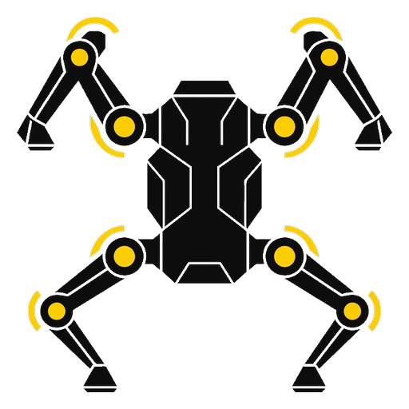
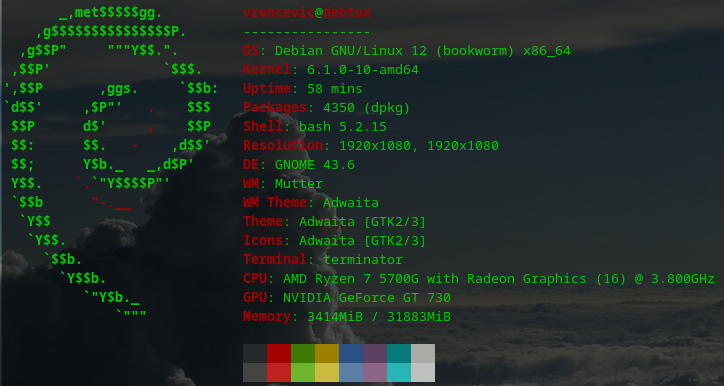
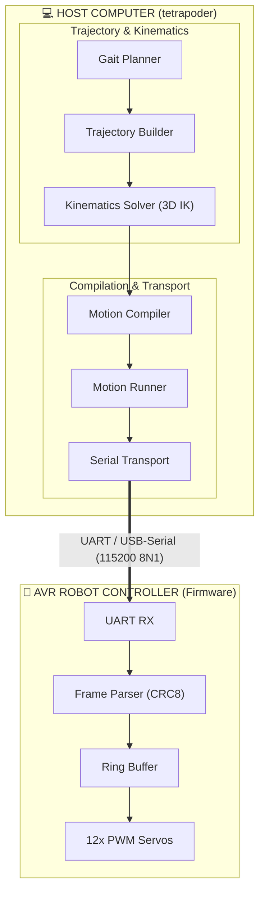
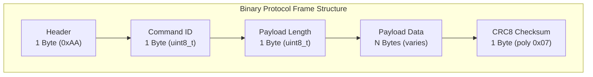
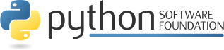

# Tetrapoder — Kinematics Compiler, Gait Planner & Trajectory Streamer



**tetrapoder** is an autonomous kinematics compilation, gait trajectory planning, and binary streaming toolchain for 12-DOF quadruped (four-legged) robots.

Developed in **[python](https://www.python.org/)** code.

The README is used to introduce the modules and provide instructions on
how to install the modules, any machine dependencies it may have and any
other information that should be provided before the modules are installed.

[](https://github.com/vroncevic/tetrapoder/actions/workflows/tetrapoder_python_checker.yml) [](https://github.com/vroncevic/tetrapoder/actions/workflows/tetrapoder_package_checker.yml) [](https://github.com/vroncevic/tetrapoder/actions/workflows/tetrapoder_interface_checker.yml) [](https://github.com/vroncevic/tetrapoder/actions/workflows/tetrapoder_isp_checker.yml) [](https://github.com/vroncevic/tetrapoder/actions/workflows/tetrapoder_srp_checker.yml) [](https://www.gnu.org/licenses/gpl-3.0) [](https://opensource.org/licenses/Apache-2.0) [](https://www.python.org/downloads/) [](https://github.com/vroncevic/tetrapoder/issues) [](https://github.com/vroncevic/tetrapoder/graphs/contributors)

<!-- START doctoc generated TOC please keep comment here to allow auto update -->
<!-- DON'T EDIT THIS SECTION, INSTEAD RE-RUN doctoc TO UPDATE -->
**Table of Contents**

- [🚀 Installation](#-installation)
    - [Install using pip](#install-using-pip)
    - [Install using build](#install-using-build)
    - [Install using py setup](#install-using-py-setup)
    - [Install using docker](#install-using-docker)
- [📦 Dependencies](#-dependencies)
- [📁 Tool structure](#-tool-structure)
  - [🏗 Architecture & SOLID Principles](#-architecture--solid-principles)
    - [Architecture & Layer Decoupling](#architecture--layer-decoupling)
    - [SOLID Principles Compliance](#solid-principles-compliance)
    - [Automated Quality Gates (`run_quality_gates.sh`)](#automated-quality-gates-run_quality_gatessh)
  - [📐 3-Link Inverse Kinematics (IK) Engine](#-3-link-inverse-kinematics-ik-engine)
    - [Kinematic Link Parameters](#kinematic-link-parameters)
    - [Analytical Closed-Form Solution](#analytical-closed-form-solution)
  - [🐾 Gait Planning & Trajectory Generation](#-gait-planning--trajectory-generation)
    - [Gait Locomotion Patterns](#gait-locomotion-patterns)
    - [Parametric Cubic Bézier Trajectories](#parametric-cubic-b%C3%A9zier-trajectories)
  - [📡 Binary Protocol & Packet Serialization](#-binary-protocol--packet-serialization)
    - [Packet Structure & CRC8 Verification](#packet-structure--crc8-verification)
    - [Binary Protocol Commands](#binary-protocol-commands)
- [📊 Code coverage](#-code-coverage)
- [🛠 Usage](#-usage)
    - [CLI Command Options](#cli-command-options)
    - [CLI Execution Examples](#cli-execution-examples)
- [📚 Docs](#-docs)
- [👥 Contributing](#-contributing)
- [📄 Copyright and licence](#-copyright-and-licence)

<!-- END doctoc generated TOC please keep comment here to allow auto update -->

### 🚀 Installation

Used next development environment



[](https://github.com/vroncevic/tetrapoder/actions/workflows/tetrapoder_python3_build.yml)

Currently there are three ways to install package
* Install process based on using pip mechanism
* Install process based on build mechanism
* Install process based on setup.py mechanism
* Install process based on docker mechanism

##### Install using pip

**tetrapoder** is located at **[pypi.org](https://pypi.org/project/tetrapoder/)**.

You can install by using pip

```bash
# python3
pip3 install tetrapoder
```

##### Install using build

Navigate to release **[page](https://github.com/vroncevic/tetrapoder/releases/)** download and extract release archive.

To install **tetrapoder** type the following

```bash
tar xvzf tetrapoder-x.y.z.tar.gz
cd tetrapoder-x.y.z/
# python3
wget https://bootstrap.pypa.io/get-pip.py
python3 get-pip.py 
python3 -m pip install --upgrade setuptools
python3 -m pip install --upgrade pip
python3 -m pip install --upgrade build
pip3 install -r requirements.txt
python3 -m build --no-isolation --wheel
pip3 install ./dist/tetrapoder-*-py3-none-any.whl
rm -f get-pip.py
chmod 755 /usr/local/lib/python3.12/dist-packages/usr/local/bin/tetrapoder_run.py
ln -s /usr/local/lib/python3.12/dist-packages/usr/local/bin/tetrapoder_run.py /usr/local/bin/tetrapoder_run.py
```

##### Install using py setup

Navigate to **[release page](https://github.com/vroncevic/tetrapoder/releases)** download and extract release archive.

To install **tetrapoder** locate and run setup.py with arguments

```bash
tar xvzf tetrapoder-x.y.z.tar.gz
cd tetrapoder-x.y.z
# python3
pip3 install -r requirements.txt
python3 setup.py install_lib
python3 setup.py install_egg_info
```

##### Install using docker

You can use Dockerfile to create image/container.

### 📦 Dependencies

**tetrapoder** requires next modules and libraries

* [ats-utilities - Python App/Tool/Script Utilities](https://pypi.org/project/ats-utilities/) [](https://www.gnu.org/licenses/gpl-3.0) [](https://opensource.org/licenses/Apache-2.0)
* [pyserial - Python Serial Port Extension](https://pypi.org/project/pyserial/) [](https://opensource.org/licenses/BSD-3-Clause)

### 📁 Tool structure

**tetrapoder** is based on OOP and Clean Architecture.

Tool structure

<details>
<summary><b>Click to expand framework structure</b></summary>

```bash
    tetrapoder/
         ├── core/
         │   ├── __init__.py
         │   ├── model/
         │   │   ├── command_id.py
         │   │   ├── exceptions/
         │   │   │   ├── compiler_error.py
         │   │   │   ├── __init__.py
         │   │   │   ├── kinematics_error.py
         │   │   │   ├── protocol_error.py
         │   │   │   ├── runner_error.py
         │   │   │   └── tetrapoder_error.py
         │   │   ├── gait_type.py
         │   │   ├── imu_telemetry.py
         │   │   ├── __init__.py
         │   │   ├── leg_angles.py
         │   │   ├── motion_plan.py
         │   │   ├── plan_command.py
         │   │   ├── point3d.py
         │   │   └── response_id.py
         │   └── service/
         │       ├── choreography/
         │       │   ├── builder.py
         │       │   ├── ibuilder.py
         │       │   └── __init__.py
         │       ├── compiler/
         │       │   ├── imotion.py
         │       │   ├── __init__.py
         │       │   └── motion.py
         │       ├── crc8/
         │       │   ├── crc.py
         │       │   ├── icrc.py
         │       │   └── __init__.py
         │       ├── gait/
         │       │   ├── builder.py
         │       │   ├── ibuilder.py
         │       │   └── __init__.py
         │       ├── __init__.py
         │       ├── kinematics/
         │       │   ├── __init__.py
         │       │   ├── isolver.py
         │       │   └── solver.py
         │       ├── protocol/
         │       │   ├── frame.py
         │       │   ├── iframe.py
         │       │   └── __init__.py
         │       ├── runner/
         │       │   ├── __init__.py
         │       │   ├── irunner.py
         │       │   └── runner.py
         │       ├── stabilizer/
         │       │   ├── compensator.py
         │       │   ├── icompensator.py
         │       │   └── __init__.py
         │       ├── telemetry/
         │       │   ├── decoder.py
         │       │   ├── idecoder.py
         │       │   └── __init__.py
         │       ├── trajectory/
         │       │   ├── builder.py
         │       │   ├── ibuilder.py
         │       │   └── __init__.py
         │       └── transport/
         │           ├── __init__.py
         │           └── itransport.py
         ├── engine.py
         ├── infrastructure/
         │   ├── cli/
         │   │   ├── engine.py
         │   │   ├── icli.py
         │   │   ├── __init__.py
         │   │   └── setup/
         │   │       ├── bundle.py
         │   │       ├── dep_validator.py
         │   │       ├── dependencies.py
         │   │       ├── factory.py
         │   │       ├── __init__.py
         │   │       ├── keys.py
         │   │       ├── opt_validator.py
         │   │       ├── options.py
         │   │       ├── registry.py
         │   │       └── validator.py
         │   ├── command/
         │   │   ├── bundle.py
         │   │   ├── definition.py
         │   │   ├── executor.py
         │   │   ├── idefinition.py
         │   │   ├── iexecutor.py
         │   │   └── __init__.py
         │   ├── config/
         │   │   ├── tetrapoder.cfg
         │   │   └── tetrapoder.logo
         │   ├── __init__.py
         │   ├── storage/
         │   │   ├── __init__.py
         │   │   ├── iwriter.py
         │   │   └── writer.py
         │   └── transport/
         │       ├── __init__.py
         │       └── serial.py
         ├── __init__.py
         ├── py.typed
         └── setup/
             ├── bundle.py
             ├── dep_validator.py
             ├── dependencies.py
             ├── factory.py
             ├── __init__.py
             ├── keys.py
             ├── opt_validator.py
             ├── options.py
             ├── registry.py
             └── validator.py

     24 directories, 89 files
```
</details>

#### 🏗 Architecture & SOLID Principles

Microcontrollers without hardware floating-point units (such as Atmel AVR ATmega328P/ATmega2560) face severe timing constraints when calculating trigonometric inverse kinematics, bezier splines, and gait state machines in real time.

**tetrapoder** offloads all heavy analytical 3D kinematics, gait scheduling, and trajectory interpolation to the host computer:



##### Architecture & Layer Decoupling

`tetrapoder` follows Clean / Hexagonal Architecture:
- `core/model/`: Pure domain entities (`Point3D`, `LegAngles`, `PlanCommand`, `MotionPlan`) and domain exceptions. Completely free of framework or I/O dependencies.
- `core/service/`: Driving and driven port interfaces (`@runtime_checkable Protocol`) and pure algorithmic domain services (`KinematicsSolver`, `GaitPlanBuilder`, `TrajectoryBuilder`, `ProtocolFrameBuilder`, `MotionCompiler`, `MotionRunner`, `CRC8`).
- `infrastructure/`: Concrete adapters implementing service ports:
  - `transport/serial_transport.py`: Hardware UART/Serial adapter.
  - `cli/`: Command-line interface parser and engine.
  - `command/`: Action definitions and execution coordinator.
- `setup/`: ATS bundle configuration, dependency injection registries, and validation pipelines.

##### SOLID Principles Compliance

- **Single Responsibility Principle (SRP)**: Each class encapsulates strictly one responsibility with $\le 6$ total methods.
- **Open/Closed Principle (OCP)**: Core solvers and planners are open for extension and closed for modification via structural protocols.
- **Liskov Substitution Principle (LSP)**: All implementations cleanly fulfill protocol contracts without runtime inheritance.
- **Interface Segregation Principle (ISP)**: Interfaces are fine-grained ($\le 9$ methods per protocol).
- **Dependency Inversion Principle (DIP)**: High-level services depend exclusively on structural interfaces, wired via `setup/factory.py`.

##### Automated Quality Gates (`run_quality_gates.sh`)

All four automated AST gate checks verify code compliance:
- `interfaces_checker.py`: Protocol adherence and method signature matching.
- `isp_checker.py`: Interface segregation principle ($\le 9$ methods per protocol).
- `limits_checker.py`: Line length ($\le 150$) and module line count ($\le 500$).
- `srp_checker.py`: Single responsibility principle ($\le 6$ methods per class).

#### 📐 3-Link Inverse Kinematics (IK) Engine

Each of the 4 robot legs consists of 3 links:

##### Kinematic Link Parameters

- **Coxa** ($L_1 = 30.0\,\text{mm}$): Horizontal yaw rotation in the X-Y plane ($\theta_{\text{coxa}}$).
- **Femur** ($L_2 = 50.0\,\text{mm}$): Vertical pitch rotation in the limb plane ($\theta_{\text{femur}}$).
- **Tibia** ($L_3 = 60.0\,\text{mm}$): Vertical knee flexion/extension in the limb plane ($\theta_{\text{tibia}}$).

##### Analytical Closed-Form Solution

Given target foot Cartesian coordinates $(x, y, z)$ relative to the leg base:

1. **Coxa Angle**:
   $$\theta_{\text{coxa}} = \operatorname{atan2}(y, x)$$

2. **Effective Limb-Plane Coordinate**:
   $$r_{\text{proj}} = \sqrt{x^2 + y^2} - L_1, \quad d = \sqrt{r_{\text{proj}}^2 + z^2}$$

3. **Femur & Tibia Angles** (Law of Cosines):
   $$\cos(\alpha) = \frac{L_2^2 + d^2 - L_3^2}{2 L_2 d}, \quad \theta_{\text{femur}} = \operatorname{atan2}(z, r_{\text{proj}}) + \alpha$$
   $$\cos(\beta) = \frac{L_2^2 + L_3^2 - d^2}{2 L_2 L_3}, \quad \theta_{\text{tibia}} = \beta$$

The solver verifies reachability ($|L_2 - L_3| \le d \le L_2 + L_3$) and maps joint angles to servo home references ($90^\circ$).

#### 🐾 Gait Planning & Trajectory Generation

##### Gait Locomotion Patterns

`tetrapoder` supports multiple locomotion modes and poses:
- **Stand**: Neutral stance with all four feet firmly on the ground.
- **Sit**: Low posture with retracted rear limbs.
- **Dance**: Wave and alternating pitch/roll movements.
- **Crawl Gait**: 4-phase wave gait where only one leg swings at any given time while the other three maintain a stable tripod base.
- **Trot Gait**: 2-phase dynamic gait swinging diagonal leg pairs simultaneously (LF+RR, then RF+LR).

##### Parametric Cubic Bézier Trajectories

Swing trajectories utilize parametric cubic Bézier curves for smooth foot lift-off, peak clearance, and ground touchdown, eliminating mechanical impact shock.

#### 📡 Binary Protocol & Packet Serialization

All communication between `tetrapoder` and the robot controller uses compact binary frames protected by CRC8-CCITT ($x^8 + x^2 + x + 1$, polynomial `0x07`).

##### Packet Structure & CRC8 Verification



##### Binary Protocol Commands

| ID | Name | Description |
|:---|:---|:---|
| `0x01` | `CMD_PING` | Ping controller (heartbeat) |
| `0x02` | `CMD_STOP` | Emergency stop / disable servos |
| `0x03` | `CMD_SET_SERVO` | Direct single-servo position command |
| `0x04` | `CMD_SET_LEG` | Direct 3-angle command for one leg |
| `0x05` | `CMD_SET_ALL_LEGS`| Direct 12-angle command for all four legs |
| `0x10` | `CMD_EXEC_PLAN` | Select and execute precompiled firmware gait |
| `0x11` | `CMD_APPEND_KEYFRAME` | Append 12-angle keyframe to ring buffer |
| `0x12` | `CMD_CLEAR_BUFFER` | Flush command execution queue |

### 📊 Code coverage

<details>
<summary><b>Click to expand code coverage</b></summary>

| Name | Stmts | Miss | Cover |
|------|-------|------|-------|
| `tetrapoder/__init__.py` | 9 | 0 | 100%|
| `tetrapoder/core/__init__.py` | 9 | 0 | 100%|
| `tetrapoder/core/model/__init__.py` | 9 | 0 | 100%|
| `tetrapoder/core/model/command_id.py` | 22 | 0 | 100%|
| `tetrapoder/core/model/exceptions/__init__.py` | 9 | 0 | 100%|
| `tetrapoder/core/model/exceptions/compiler_error.py` | 11 | 0 | 100%|
| `tetrapoder/core/model/exceptions/kinematics_error.py` | 11 | 0 | 100%|
| `tetrapoder/core/model/exceptions/protocol_error.py` | 11 | 0 | 100%|
| `tetrapoder/core/model/exceptions/runner_error.py` | 11 | 0 | 100%|
| `tetrapoder/core/model/exceptions/tetrapoder_error.py` | 10 | 0 | 100%|
| `tetrapoder/core/model/gait_type.py` | 18 | 0 | 100%|
| `tetrapoder/core/model/imu_telemetry.py` | 18 | 0 | 100%|
| `tetrapoder/core/model/leg_angles.py` | 15 | 0 | 100%|
| `tetrapoder/core/model/motion_plan.py` | 14 | 0 | 100%|
| `tetrapoder/core/model/plan_command.py` | 15 | 0 | 100%|
| `tetrapoder/core/model/point3d.py` | 15 | 0 | 100%|
| `tetrapoder/core/model/response_id.py` | 16 | 0 | 100%|
| `tetrapoder/core/service/__init__.py` | 9 | 0 | 100%|
| `tetrapoder/core/service/choreography/__init__.py` | 9 | 0 | 100%|
| `tetrapoder/core/service/choreography/builder.py` | 33 | 0 | 100%|
| `tetrapoder/core/service/choreography/ibuilder.py` | 17 | 0 | 100%|
| `tetrapoder/core/service/compiler/__init__.py` | 9 | 0 | 100%|
| `tetrapoder/core/service/compiler/imotion.py` | 16 | 0 | 100%|
| `tetrapoder/core/service/compiler/motion.py` | 23 | 0 | 100%|
| `tetrapoder/core/service/crc8/__init__.py` | 9 | 0 | 100%|
| `tetrapoder/core/service/crc8/crc.py` | 23 | 0 | 100%|
| `tetrapoder/core/service/crc8/icrc.py` | 14 | 0 | 100%|
| `tetrapoder/core/service/gait/__init__.py` | 9 | 0 | 100%|
| `tetrapoder/core/service/gait/builder.py` | 41 | 0 | 100%|
| `tetrapoder/core/service/gait/ibuilder.py` | 18 | 0 | 100%|
| `tetrapoder/core/service/kinematics/__init__.py` | 9 | 0 | 100%|
| `tetrapoder/core/service/kinematics/isolver.py` | 18 | 0 | 100%|
| `tetrapoder/core/service/kinematics/solver.py` | 53 | 0 | 100%|
| `tetrapoder/core/service/protocol/__init__.py` | 9 | 0 | 100%|
| `tetrapoder/core/service/protocol/frame.py` | 41 | 0 | 100%|
| `tetrapoder/core/service/protocol/iframe.py` | 14 | 0 | 100%|
| `tetrapoder/core/service/runner/__init__.py` | 9 | 0 | 100%|
| `tetrapoder/core/service/runner/irunner.py` | 16 | 0 | 100%|
| `tetrapoder/core/service/runner/runner.py` | 44 | 0 | 100%|
| `tetrapoder/core/service/stabilizer/__init__.py` | 9 | 0 | 100%|
| `tetrapoder/core/service/stabilizer/compensator.py` | 42 | 0 | 100%|
| `tetrapoder/core/service/stabilizer/icompensator.py` | 16 | 0 | 100%|
| `tetrapoder/core/service/telemetry/__init__.py` | 9 | 0 | 100%|
| `tetrapoder/core/service/telemetry/decoder.py` | 24 | 0 | 100%|
| `tetrapoder/core/service/telemetry/idecoder.py` | 15 | 0 | 100%|
| `tetrapoder/core/service/trajectory/__init__.py` | 9 | 0 | 100%|
| `tetrapoder/core/service/trajectory/builder.py` | 35 | 0 | 100%|
| `tetrapoder/core/service/trajectory/ibuilder.py` | 18 | 0 | 100%|
| `tetrapoder/core/service/transport/__init__.py` | 9 | 0 | 100%|
| `tetrapoder/core/service/transport/itransport.py` | 17 | 0 | 100%|
| `tetrapoder/engine.py` | 61 | 0 | 100%|
| `tetrapoder/infrastructure/__init__.py` | 9 | 0 | 100%|
| `tetrapoder/infrastructure/cli/__init__.py` | 9 | 0 | 100%|
| `tetrapoder/infrastructure/cli/engine.py` | 41 | 0 | 100%|
| `tetrapoder/infrastructure/cli/icli.py` | 15 | 0 | 100%|
| `tetrapoder/infrastructure/cli/setup/__init__.py` | 9 | 0 | 100%|
| `tetrapoder/infrastructure/cli/setup/bundle.py` | 20 | 0 | 100%|
| `tetrapoder/infrastructure/cli/setup/dep_validator.py` | 37 | 0 | 100%|
| `tetrapoder/infrastructure/cli/setup/dependencies.py` | 16 | 0 | 100%|
| `tetrapoder/infrastructure/cli/setup/factory.py` | 29 | 0 | 100%|
| `tetrapoder/infrastructure/cli/setup/keys.py` | 23 | 0 | 100%|
| `tetrapoder/infrastructure/cli/setup/opt_validator.py` | 35 | 0 | 100%|
| `tetrapoder/infrastructure/cli/setup/options.py` | 13 | 0 | 100%|
| `tetrapoder/infrastructure/cli/setup/registry.py` | 29 | 0 | 100%|
| `tetrapoder/infrastructure/cli/setup/validator.py` | 38 | 0 | 100%|
| `tetrapoder/infrastructure/command/__init__.py` | 9 | 0 | 100%|
| `tetrapoder/infrastructure/command/bundle.py` | 16 | 0 | 100%|
| `tetrapoder/infrastructure/command/definition.py` | 24 | 0 | 100%|
| `tetrapoder/infrastructure/command/executor.py` | 72 | 0 | 100%|
| `tetrapoder/infrastructure/command/idefinition.py` | 20 | 0 | 100%|
| `tetrapoder/infrastructure/command/iexecutor.py` | 16 | 0 | 100%|
| `tetrapoder/infrastructure/storage/__init__.py` | 9 | 0 | 100%|
| `tetrapoder/infrastructure/storage/iwriter.py` | 14 | 0 | 100%|
| `tetrapoder/infrastructure/storage/writer.py` | 21 | 0 | 100%|
| `tetrapoder/infrastructure/transport/__init__.py` | 9 | 0 | 100%|
| `tetrapoder/infrastructure/transport/serial.py` | 48 | 0 | 100%|
| `tetrapoder/setup/__init__.py` | 9 | 0 | 100%|
| `tetrapoder/setup/bundle.py` | 19 | 0 | 100%|
| `tetrapoder/setup/dep_validator.py` | 37 | 0 | 100%|
| `tetrapoder/setup/dependencies.py` | 15 | 0 | 100%|
| `tetrapoder/setup/factory.py` | 38 | 0 | 100%|
| `tetrapoder/setup/keys.py` | 24 | 0 | 100%|
| `tetrapoder/setup/opt_validator.py` | 35 | 0 | 100%|
| `tetrapoder/setup/options.py` | 13 | 0 | 100%|
| `tetrapoder/setup/registry.py` | 28 | 0 | 100%|
| `tetrapoder/setup/validator.py` | 38 | 0 | 100%|
| **Total** | 1767 | 0 | 100% |

</details>

### 🛠 Usage

Install package

```bash
pip3 install tetrapoder
```

Prepare main entry point by downloading [main.py](https://raw.githubusercontent.com/vroncevic/tetrapoder/main/main.py) or create your own.

```bash
wget -O main.py https://raw.githubusercontent.com/vroncevic/tetrapoder/main/main.py
```

##### CLI Command Options

The tool is invoked via `run.sh` or the installed `tetrapoder` CLI executable.

| Option | Type | Choices | Description |
|---|:---:|:---:|---|
| **`--action`** | `str` | `ping`, `stop`, `compile`, `upload`, `direct` | Execution action to perform |
| **`--gait`** | `str` | `stand`, `sit`, `dance`, `crawl`, `trot` | Gait pattern for compile or upload |
| **`--output`** | `str` | *File path* | Output binary plan file path (`.bin`) |
| **`--port`** | `str` | *Port device* | Serial port (e.g., `/dev/ttyUSB0`) |
| **`--baudrate`** | `int` | *Baud rate* | Serial baud rate (default: `115200`) |
| **`--angles`** | `str` | *CSV angles* | 12 comma-separated angles in degrees for direct mode |
| **`--time`** | `int` | *Duration ms* | Step duration in milliseconds |
| **`--verbose`** | `bool` | *Flag* | Enable verbose ATS operational logging |

##### CLI Execution Examples

```bash
# Display help and usage
./run.sh robot --help

# Ping the robot controller
./run.sh robot --action ping --port /dev/ttyUSB0 --baudrate 115200

# Emergency stop
./run.sh robot --action stop --port /dev/ttyUSB0

# Compile a gait plan into a binary file
./run.sh robot --action compile --gait crawl --output motion_crawl.bin

# Compile and immediately upload/stream to the robot
./run.sh robot --action upload --gait crawl --port /dev/ttyUSB0

# Direct command: set all 4 legs to 90 degrees with 200 ms transition
./run.sh robot --action direct --angles 90,90,90,90,90,90,90,90,90,90,90,90 --time 200 --port /dev/ttyUSB0
```

### 📚 Docs

[](https://tetrapoder.readthedocs.io/en/latest/?badge=latest)

More documentation and info at

* [tetrapoder.readthedocs.io](https://tetrapoder.readthedocs.io)
* [www.python.org](https://www.python.org/)

### 👥 Contributing

[Contributing to tetrapoder](CONTRIBUTING.md)

### 📄 Copyright and licence

[](https://www.gnu.org/licenses/gpl-3.0) [](https://opensource.org/licenses/Apache-2.0)

Copyright (C) 2026 by [vroncevic.github.io/tetrapoder](https://vroncevic.github.io/tetrapoder)

**tetrapoder** is free software; you can redistribute it and/or modify
it under the same terms as Python itself, either Python version 3.x or,
at your option, any later version of Python 3 you may have available.

Special thanks to **Google** and the Google developer ecosystem for their tremendous support and innovative tools from the Google bundle that empowered the development and realization of this project. *Google, you make this world a better place!* 🌍✨

Lets help and support PSF.

[](https://www.python.org/psf/)

[](https://www.python.org/psf/donations/)
