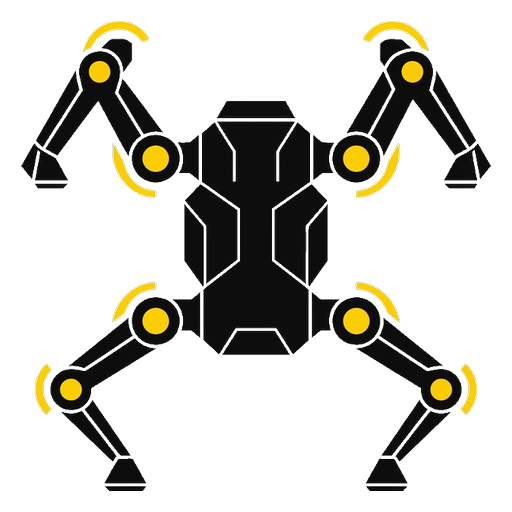
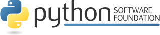

Kinematics Compiler, Gait Planner & Trajectory Streamer
-------------------------------------------------------

**tetrapoder** is an autonomous kinematics compilation, gait trajectory planning, and binary streaming toolchain for 12-DOF quadruped (four-legged) robots.

Developed in `python <https://www.python.org/>`_ code.

The README is used to introduce the tool and provide instructions on
how to install the tool, any machine dependencies it may have and any
other information that should be provided before the tool is installed.

|tetrapoder python checker| |tetrapoder python package| |tetrapoder interface checker| |tetrapoder isp checker| |tetrapoder srp checker| |gplv3 license| |apache license| |python version| |github issues| |documentation status| |github contributors|

.. |tetrapoder python checker| image:: https://github.com/vroncevic/tetrapoder/actions/workflows/tetrapoder_python_checker.yml/badge.svg
   :target: https://github.com/vroncevic/tetrapoder/actions/workflows/tetrapoder_python_checker.yml

.. |tetrapoder python package| image:: https://github.com/vroncevic/tetrapoder/actions/workflows/tetrapoder_package_checker.yml/badge.svg
   :target: https://github.com/vroncevic/tetrapoder/actions/workflows/tetrapoder_package_checker.yml

.. |tetrapoder interface checker| image:: https://github.com/vroncevic/tetrapoder/actions/workflows/tetrapoder_interface_checker.yml/badge.svg
   :target: https://github.com/vroncevic/tetrapoder/actions/workflows/tetrapoder_interface_checker.yml

.. |tetrapoder isp checker| image:: https://github.com/vroncevic/tetrapoder/actions/workflows/tetrapoder_isp_checker.yml/badge.svg
   :target: https://github.com/vroncevic/tetrapoder/actions/workflows/tetrapoder_isp_checker.yml

.. |tetrapoder srp checker| image:: https://github.com/vroncevic/tetrapoder/actions/workflows/tetrapoder_srp_checker.yml/badge.svg
   :target: https://github.com/vroncevic/tetrapoder/actions/workflows/tetrapoder_srp_checker.yml

.. |gplv3 license| image:: https://img.shields.io/badge/License-GPLv3-blue.svg
   :target: https://www.gnu.org/licenses/gpl-3.0

.. |apache license| image:: https://img.shields.io/badge/License-Apache%202.0-blue.svg
   :target: https://opensource.org/licenses/Apache-2.0

.. |python version| image:: https://img.shields.io/badge/python-3.12+-blue.svg
   :target: https://www.python.org/downloads/

.. |github issues| image:: https://img.shields.io/github/issues/vroncevic/tetrapoder.svg
   :target: https://github.com/vroncevic/tetrapoder/issues

.. |github contributors| image:: https://img.shields.io/github/contributors/vroncevic/tetrapoder.svg
   :target: https://github.com/vroncevic/tetrapoder/graphs/contributors

.. |documentation status| image:: https://readthedocs.org/projects/tetrapoder/badge/?version=latest
   :target: https://tetrapoder.readthedocs.io/en/latest/?badge=latest

.. toctree::
   :maxdepth: 4
   :caption: Contents

   self
   modules

🚀 Installation
---------------

|tetrapoder python3 build|

.. |tetrapoder python3 build| image:: https://github.com/vroncevic/tetrapoder/actions/workflows/tetrapoder_python3_build.yml/badge.svg
   :target: https://github.com/vroncevic/tetrapoder/actions/workflows/tetrapoder_python3_build.yml

Navigate to release `page`_ download and extract release archive.

.. _page: https://github.com/vroncevic/tetrapoder/releases

To install **tetrapoder** type the following

.. code-block:: bash

    tar xvzf tetrapoder-x.y.z.tar.gz
    cd tetrapoder-x.y.z/
    # python3
    wget https://bootstrap.pypa.io/get-pip.py
    python3 get-pip.py 
    python3 -m pip install --upgrade setuptools
    python3 -m pip install --upgrade pip
    python3 -m pip install --upgrade build
    pip3 install -r requirements.txt
    python3 -m build --no-isolation --wheel
    pip3 install ./dist/tetrapoder-*-py3-none-any.whl
    rm -f get-pip.py
    chmod 755 /usr/local/lib/python3.12/dist-packages/usr/local/bin/tetrapoder_run.py
    ln -s /usr/local/lib/python3.12/dist-packages/usr/local/bin/tetrapoder_run.py /usr/local/bin/tetrapoder_run.py

You can use Docker to create image/container, or You can use pip to install

.. code-block:: bash

    # python3
    pip3 install tetrapoder

📦 Dependencies
---------------

**tetrapoder** requires next modules and libraries

* `ats-utilities - Python App/Tool/Script Utilities <https://pypi.org/project/ats-utilities/>`_ |ats gplv3| |ats apache|
* `pyserial - Python Serial Port Extension <https://pypi.org/project/pyserial/>`_ |pyserial bsd|

.. |ats gplv3| image:: https://img.shields.io/badge/License-GPLv3-blue.svg
   :target: https://www.gnu.org/licenses/gpl-3.0

.. |ats apache| image:: https://img.shields.io/badge/License-Apache%202.0-blue.svg
   :target: https://opensource.org/licenses/Apache-2.0

.. |pyserial bsd| image:: https://img.shields.io/badge/License-BSD_3--Clause-blue.svg
   :target: https://opensource.org/licenses/BSD-3-Clause

📁 Tool structure
-----------------

**tetrapoder** is based on OOP and Clean Architecture.

Tool structure

.. code-block:: bash

    tetrapoder/
         ├── core/
         │   ├── __init__.py
         │   ├── model/
         │   │   ├── command_id.py
         │   │   ├── exceptions/
         │   │   │   ├── compiler_error.py
         │   │   │   ├── __init__.py
         │   │   │   ├── kinematics_error.py
         │   │   │   ├── protocol_error.py
         │   │   │   ├── runner_error.py
         │   │   │   └── tetrapoder_error.py
         │   │   ├── gait_type.py
         │   │   ├── imu_telemetry.py
         │   │   ├── __init__.py
         │   │   ├── leg_angles.py
         │   │   ├── motion_plan.py
         │   │   ├── plan_command.py
         │   │   ├── point3d.py
         │   │   └── response_id.py
         │   └── service/
         │       ├── choreography/
         │       │   ├── builder.py
         │       │   ├── ibuilder.py
         │       │   └── __init__.py
         │       ├── compiler/
         │       │   ├── imotion.py
         │       │   ├── __init__.py
         │       │   └── motion.py
         │       ├── crc8/
         │       │   ├── crc.py
         │       │   ├── icrc.py
         │       │   └── __init__.py
         │       ├── gait/
         │       │   ├── builder.py
         │       │   ├── ibuilder.py
         │       │   └── __init__.py
         │       ├── __init__.py
         │       ├── kinematics/
         │       │   ├── __init__.py
         │       │   ├── isolver.py
         │       │   └── solver.py
         │       ├── protocol/
         │       │   ├── frame.py
         │       │   ├── iframe.py
         │       │   └── __init__.py
         │       ├── runner/
         │       │   ├── __init__.py
         │       │   ├── irunner.py
         │       │   └── runner.py
         │       ├── stabilizer/
         │       │   ├── compensator.py
         │       │   ├── icompensator.py
         │       │   └── __init__.py
         │       ├── telemetry/
         │       │   ├── decoder.py
         │       │   ├── idecoder.py
         │       │   └── __init__.py
         │       ├── trajectory/
         │       │   ├── builder.py
         │       │   ├── ibuilder.py
         │       │   └── __init__.py
         │       └── transport/
         │           ├── __init__.py
         │           └── itransport.py
         ├── engine.py
         ├── infrastructure/
         │   ├── cli/
         │   │   ├── engine.py
         │   │   ├── icli.py
         │   │   ├── __init__.py
         │   │   └── setup/
         │   │       ├── bundle.py
         │   │       ├── dep_validator.py
         │   │       ├── dependencies.py
         │   │       ├── factory.py
         │   │       ├── __init__.py
         │   │       ├── keys.py
         │   │       ├── opt_validator.py
         │   │       ├── options.py
         │   │       ├── registry.py
         │   │       └── validator.py
         │   ├── command/
         │   │   ├── bundle.py
         │   │   ├── definition.py
         │   │   ├── executor.py
         │   │   ├── idefinition.py
         │   │   ├── iexecutor.py
         │   │   └── __init__.py
         │   ├── config/
         │   │   ├── tetrapoder.cfg
         │   │   └── tetrapoder.logo
         │   ├── __init__.py
         │   ├── storage/
         │   │   ├── __init__.py
         │   │   ├── iwriter.py
         │   │   └── writer.py
         │   └── transport/
         │       ├── __init__.py
         │       └── serial.py
         ├── __init__.py
         ├── py.typed
         └── setup/
             ├── bundle.py
             ├── dep_validator.py
             ├── dependencies.py
             ├── factory.py
             ├── __init__.py
             ├── keys.py
             ├── opt_validator.py
             ├── options.py
             ├── registry.py
             └── validator.py

     24 directories, 89 files

🏗 Architecture & SOLID Principles
---------------------------------

**tetrapoder** follows Clean / Hexagonal Architecture:

* ``core/model/``: Pure domain entities (``Point3D``, ``LegAngles``, ``PlanCommand``, ``MotionPlan``) and domain exceptions. Completely free of framework or I/O dependencies.
* ``core/service/``: Driving and driven port interfaces (``@runtime_checkable Protocol``) and pure algorithmic domain services (``KinematicsSolver``, ``GaitPlanBuilder``, ``TrajectoryBuilder``, ``ProtocolFrameBuilder``, ``MotionCompiler``, ``MotionRunner``, ``CRC8``).
* ``infrastructure/``: Concrete adapters implementing service ports:
  * ``transport/serial_transport.py``: Hardware UART/Serial adapter.
  * ``cli/``: Command-line interface parser and engine.
  * ``command/``: Action definitions and execution coordinator.
* ``setup/``: ATS bundle configuration, dependency injection registries, and validation pipelines.

Architectural Rules
^^^^^^^^^^^^^^^^^^^

1. Maximum 6 methods per class (including ``__init__``, properties, and dunders).
2. Strictly zero private methods (``def _...``); capabilities are composed and delegated via public contracts.
3. Strictly zero ``typing.Any`` across the entire codebase.
4. One class or interface per module.
5. 100% decoupling: concrete implementations do not inherit from ``Protocol`` interfaces.

📐 3-Link Inverse Kinematics (IK) Engine
----------------------------------------

Each of the 4 robot legs consists of 3 links:

* **Coxa** (:math:`L_1 = 30.0\,\text{mm}`): Horizontal yaw rotation in the X-Y plane (:math:`\theta_{\text{coxa}}`).
* **Femur** (:math:`L_2 = 50.0\,\text{mm}`): Vertical pitch rotation in the limb plane (:math:`\theta_{\text{femur}}`).
* **Tibia** (:math:`L_3 = 60.0\,\text{mm}`): Vertical knee flexion/extension in the limb plane (:math:`\theta_{\text{tibia}}`).

The solver verifies reachability and maps joint angles to servo home references (:math:`90^\circ`).

🐾 Gait Planning & Trajectory Generation
----------------------------------------

**tetrapoder** supports multiple locomotion modes and poses:

* **Stand**: Neutral stance with all four feet firmly on the ground.
* **Sit**: Low posture with retracted rear limbs.
* **Dance**: Wave and alternating pitch/roll movements.
* **Crawl Gait**: 4-phase wave gait where only one leg swings at any given time while the other three maintain a stable tripod base.
* **Trot Gait**: 2-phase dynamic gait swinging diagonal leg pairs simultaneously (LF+RR, then RF+LR).

Swing trajectories utilize parametric cubic Bézier curves for smooth foot lift-off, peak clearance, and ground touchdown, eliminating mechanical impact shock.

📡 Binary Protocol & Packet Serialization
-----------------------------------------

All communication between **tetrapoder** and the robot controller uses compact binary frames protected by CRC8-CCITT (:math:`x^8 + x^2 + x + 1`, polynomial ``0x07``).

Commands
^^^^^^^^

* ``0x01`` (``CMD_PING``): Ping controller (heartbeat)
* ``0x02`` (``CMD_STOP``): Emergency stop / disable servos
* ``0x03`` (``CMD_SET_SERVO``): Direct single-servo position command
* ``0x04`` (``CMD_SET_LEG``): Direct 3-angle command for one leg
* ``0x05`` (``CMD_SET_ALL_LEGS``): Direct 12-angle command for all four legs
* ``0x10`` (``CMD_EXEC_PLAN``): Select and execute precompiled firmware gait
* ``0x11`` (``CMD_APPEND_KEYFRAME``): Append 12-angle keyframe to ring buffer
* ``0x12`` (``CMD_CLEAR_BUFFER``): Flush command execution queue

📊 Code coverage
----------------

.. csv-table:: Code coverage
   :file: coverage_table.csv
   :widths: 60, 10, 10, 20
   :header-rows: 1

🛠 Usage
--------

Install package

.. code-block:: bash

    pip3 install tetrapoder

Prepare main entry point by downloading `main.py` or create your own.

.. code-block:: bash

    wget -O main.py https://raw.githubusercontent.com/vroncevic/tetrapoder/main/main.py

CLI Command Options
^^^^^^^^^^^^^^^^^^^

The tool is invoked via ``run.sh`` or the installed ``tetrapoder`` CLI executable.

.. list-table:: CLI Options
   :widths: 20 15 25 40
   :header-rows: 1

   * - Option
     - Type
     - Choices
     - Description
   * - **--action**
     - ``str``
     - ``ping``, ``stop``, ``compile``, ``upload``, ``direct``
     - Execution action to perform
   * - **--gait**
     - ``str``
     - ``stand``, ``sit``, ``dance``, ``crawl``, ``trot``
     - Gait pattern for compile or upload
   * - **--output**
     - ``str``
     - *File path*
     - Output binary plan file path (``.bin``)
   * - **--port**
     - ``str``
     - *Port device*
     - Serial port (e.g., ``/dev/ttyUSB0``)
   * - **--baudrate**
     - ``int``
     - *Baud rate*
     - Serial baud rate (default: ``115200``)
   * - **--angles**
     - ``str``
     - *CSV angles*
     - 12 comma-separated angles in degrees for direct mode
   * - **--time**
     - ``int``
     - *Duration ms*
     - Step duration in milliseconds
   * - **--verbose**
     - ``bool``
     - *Flag*
     - Enable verbose ATS operational logging

CLI Execution Examples
^^^^^^^^^^^^^^^^^^^^^^

.. code-block:: bash

    # Display help and usage
    ./run.sh robot --help

    # Ping the robot controller
    ./run.sh robot --action ping --port /dev/ttyUSB0 --baudrate 115200

    # Emergency stop
    ./run.sh robot --action stop --port /dev/ttyUSB0

    # Compile a gait plan into a binary file
    ./run.sh robot --action compile --gait crawl --output motion_crawl.bin

    # Compile and immediately upload/stream to the robot
    ./run.sh robot --action upload --gait crawl --port /dev/ttyUSB0

    # Direct command: set all 4 legs to 90 degrees with 200 ms transition
    ./run.sh robot --action direct --angles 90,90,90,90,90,90,90,90,90,90,90,90 --time 200 --port /dev/ttyUSB0

📚 Docs
-------

More documentation and info at

* `tetrapoder.readthedocs.io <https://tetrapoder.readthedocs.io>`_
* `www.python.org <https://www.python.org/>`_

👥 Contributing
---------------

`Contributing to tetrapoder <https://github.com/vroncevic/tetrapoder/blob/dev/CONTRIBUTING.md>`_

📄 Copyright and licence
-------------------------

|gplv3 license| |apache license|

Copyright (C) 2026 by `vroncevic.github.io/tetrapoder <https://vroncevic.github.io/tetrapoder>`_

**tetrapoder** is free software; you can redistribute it and/or modify
it under the same terms as Python itself, either Python version 3.x or,
at your option, any later version of Python 3 you may have available.

Special thanks to **Google** and the Google developer ecosystem for their tremendous support and innovative tools from the Google bundle that empowered the development and realization of this project. *Google, you make this world a better place!* 🌍✨

Lets help and support PSF.

|python software foundation|

|donate|

.. |donate| image:: https://www.paypalobjects.com/en_US/i/btn/btn_donateCC_LG.gif
   :target: https://www.python.org/psf/donations/
